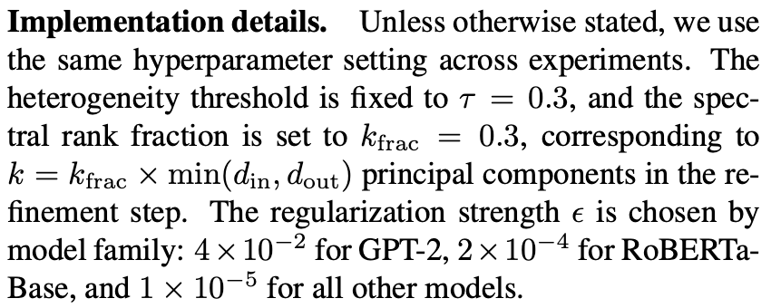

# ACE-Merging

<p align="center">
  <a href="./README.zh-CN.md">中文</a> |
  <a href="./README.md">English</a>
</p>

Official implementation for the CVPR 2026 paper:

**ACE-Merging: Data-Free Model Merging with Adaptive Covariance Estimation**

ACE-Merging is a **data-free model merging** method that merges multiple task-specific fine-tuned expert models into a single static multi-task model without requiring access to the original training data.

---

## Latest News

- This repository provides the implementation and reproduction pipeline for ACE-Merging experiments on GPT-2, ViT, and RoBERTa.
- ACE-Merging targets the data-free model merging setting: only the base model and fine-tuned checkpoints are required; no original training data is needed.

---

## Method Overview

The goal of model merging is to combine multiple task expert models into a unified model while preserving the capabilities of each expert as much as possible. Similar to RegMean-style methods, ACE-Merging starts from the objective of minimizing the prediction discrepancy between the merged model and each individual expert model.

RegMean guides model merging using the input covariance computed from task data, and therefore still depends on input data. In real-world scenarios, however, the original fine-tuning data is often unavailable due to privacy, storage, or deployment constraints.

The key observation behind ACE-Merging is:

> After SFT, the change in model parameters is not merely a weight shift; it may implicitly encode information about the task data distribution.

Given a base model $(W_0)$ and a fine-tuned expert $(W_t)$, ACE-Merging first computes the task vector:

```text
ΔW_t = W_t - W_0
```

Conventional RegMean requires input samples to estimate the covariance. In contrast, ACE-Merging estimates a task-related covariance proxy directly from the fine-tuning update itself:

```text
Σ_t ≈ ΔW_t^T ΔW_t
```

Therefore, ACE-Merging preserves the RegMean idea of covariance-based closed-form merging while removing the dependency on task data.

---

## Key Features

- **Data-free**: Requires no access to any training data.
- **Closed-form merging**: Requires no additional fine-tuning or gradient-based optimization.
- **Covariance-aware**: Uses task vectors to estimate task-related second-order structure.
- **Adaptive normalization**: Automatically handles differences in update magnitude across tasks.
- **Spectral correction**: Improves merging stability under strong task heterogeneity.
- **Support for multiple model families**: The code supports GPT-2, RoBERTa, ViT, and LLaMA-style checkpoints.

---

## Method Components

ACE-Merging consists of three main components:

1. **Adaptive covariance estimation**
   Estimates task-related covariance structure from fine-tuning updates.

2. **Adaptive covariance normalization**
   Normalizes covariance estimates when parameter update scales differ significantly across tasks, reducing inter-task interference.

3. **Spectral correction**
   Introduces a low-rank correction when the singular value distribution of the preliminary merged result is overly concentrated, improving stability.

The entire pipeline requires neither training data nor gradient computation, and produces a static merged model.

---

## Repository Structure

```text
ACE-Merging/
├── main.py                         # Main entry point
├── draw.py                         # Visualization tool
├── control/
│   ├── config.py                   # Configuration management
│   └── pipeline.py                 # Pipeline controller
├── src/
│   ├── merge/
│   │   ├── strategy.py             # Merging strategies, including ACE
│   │   └── sparsify.py             # Sparsification utilities
│   ├── models/
│   │   ├── modeling.py             # ViT wrapper
│   │   └── heads.py                # Classification heads
│   ├── datasets/                   # Dataset loading
│   └── steps/
│       ├── step0.py                # Check or load task vectors
│       ├── step1.py                # Compute task vectors
│       ├── step2.py                # Sparsification step (you can customize the algorithm)
│       └── step3.py                # Merge and save the model
├── evaluation/
│   ├── vit/
│   │   ├── eval_vit.py             # ViT evaluation
│   │   └── get_average_score.py
│   └── lm/
│       ├── eval.py
│       ├── eval_bert.py
│       └── eval_gpt.py
├── utils/
│   ├── common.py
│   ├── task_vector.py
│   └── download_checkpoints.py
└── data/                           # checkpoints, task vectors, configs, and merged models
```

---

## Supported Models

| Model family   | Base models                  | Tasks                  |
| -------------- | ---------------------------- | ---------------------- |
| ViT / OpenCLIP | ViT-B-32, ViT-B-16, ViT-L-14 | Up to 20 image classification tasks |
| RoBERTa        | roberta-base, roberta-large  | GLUE                   |
| GPT-2          | gpt2                         | GLUE-style classification tasks |
| LLaMA          | Llama-3.2-3B-Instruct        | Multilingual, math, and code |

---

## Installation

Clone the repository:

```bash
git clone https://github.com/unravel-xu/ACE-Merging.git
cd ACE-Merging
```

Create a conda environment:

```bash
conda create -n ace-merging python=3.10
conda activate ace-merging
```

Install PyTorch according to your CUDA version. The following example uses CUDA 11.8:

```bash
pip install torch==2.4.0 torchvision==0.19.0 torchaudio==2.4.0 --index-url https://download.pytorch.org/whl/cu118
```

Install other dependencies:

```bash
pip install transformers==4.51.3
pip install open_clip_torch
pip install datasets
pip install accelerate
pip install easydict
pip install torchmetrics
pip install gdown
```

---

# GPT-2 Quick Reproduction

## 1. Configure GPT-2 Merging

Modify `ACE-Merging/control/config.py`:

```python
import os
import json
from pathlib import Path
from datetime import datetime
from easydict import EasyDict

class ConfigManager:
    def __init__(self):
        self.with_sparisfy = False
        self.with_merge = True
        self.model_type = 'lm'
        self.lm_type = 'gpt2'
        self.merge_layers = 'auto'
        self.device = "cuda:0"
        
        self.basic = EasyDict({
            'config_save_path': f'./data/configs/{self.model_type}',
            'task_vector_dir': './data/task_vectors/',
            'model_id_list': [
                'gpt2',
                'tanganke/gpt2_cola',
                'tanganke/gpt2_sst2',
                'tanganke/gpt2_mrpc',
                'tanganke/gpt2_qqp',
                'tanganke/gpt2_mnli',
                'tanganke/gpt2_qnli',
                'tanganke/gpt2_rte'
            ],
        })

        self.merge = EasyDict({
            "method": "average",
            "scaling_coefficient": 1.0,
        })

        self.sparsify = EasyDict({
            'method': 'rescaled_random',
            'place': ['front'],
            'density': 0.9,
            'rescale': True
        })

        self.runtime = EasyDict()

        os.makedirs(self.basic.config_save_path, exist_ok=True)
        self.basic.task_id = datetime.now().strftime("%Y-%m-%d-%H-%M-%S")
        config_path = f'{self.basic.config_save_path}/{self.basic.task_id}.json'  
        self.basic.config_path = Path(config_path)

    def print_info(self):
        print(json.dumps(self.__dict__, indent=4, default=str))
    
    def save_config(self):
        exclude_keys = ['base_model', 'select_layers', 'datasets']
        def to_serializable(obj):
            if isinstance(obj, EasyDict):
                return {k: to_serializable(v) for k, v in obj.items()}
            elif isinstance(obj, dict):
                return {k: to_serializable(v) for k, v in obj.items()}
            elif isinstance(obj, (list, tuple)):
                return [to_serializable(i) for i in obj]
            elif isinstance(obj, Path):
                return str(obj)
            else:
                return obj
        sanitized = {}
        if not self.with_sparisfy:
            exclude_keys.append('sparsify')
        for k, v in self.__dict__.items():
            if k in exclude_keys:
                continue
            sanitized[k] = to_serializable(v)
        with open(self.basic.config_path, "w", encoding='utf-8') as f:
            json.dump(sanitized, f, indent=4, ensure_ascii=False)
```

## 2. Run Merging

```bash
python main.py
```

This should automatically download the GPT-2 models and perform the simplest average merging. The expected output is as follows:

```bash
[STEP0] Running...
[STEP0] All task vectors already exist.
[STEP0] Done

[STEP3] Running...
gpt2
Mode: add
Updating layer: ...
...
Keeping base model layer: score.weight
============================ This is the save path of the merged model (assumed here to be YOURPATH)============================
[STEP3] Done
```

Copy the model save path from the bash output as `YOURPATH`.

## 3. Evaluate GPT-2



If needed, you can modify:

```text
ACE-Merging/src/merge/strategy.py
```

the function parameters:

```python
ace_merging(self, eps=1e-2, k_frac=0.3)
```

Copy the merged model save path `YOURPATH` from the bash output to line 188 of `ACE-Merging/evaluation/lm/eval_gpt.py`:

```python
models = []
loaders = []
device = 'cuda'
merged_model = GPT2ForSequenceClassification.from_pretrained(YOURPATH) # change this to YOURPATH
merged_model.to(device)
```

Run:

```bash
cd ACE-Merging/evaluation/lm/
python eval_gpt.py
```

The evaluation will then be executed.

---

# ViT Quick Reproduction

## Verified ViT Reproduction Settings

The following configurations were checked in additional reproduction runs using
the **historical ACE/TSV checkpoints**, FP32, QuickGELU, and disabled AMP/TF32.
They are newly verified reproduction settings, rather than reconstructed original
experiment command lines. Accuracy is the unweighted mean over complete task test
sets; it does not imply that every individual task matches the paper.

| Model | Tasks | `scaling_coefficient` | `ace_eps` | `ace_k_frac` | `ace_tau` | Reproduced mean (%) | Paper mean (%) |
|---|---:|---:|---:|---:|---:|---:|---:|
| ViT-B-32 | 8 | 1.0 | 1e-5 | 0.5 | 0.03 | 88.5174 | 87.88 |
| ViT-B-32 | 14 | 1.0 | 1e-5 | 0.5 | 0.03 | 83.6653 | 82.29 |
| ViT-B-32 | 20 | 1.0 | 1e-5 | 0.5 | 0.03 | 80.3598 | 78.83 |
| ViT-B-16 | 8 | 1.0 | 1e-5 | 0.5 | 0.03 | 91.3526 | 90.60 |
| ViT-B-16 | 14 | 1.0 | 1e-5 | 0.5 | 0.03 | 87.0789 | 86.12 |
| ViT-B-16 | 20 | 1.0 | 1e-5 | 0.5 | 0.03 | 83.9143 | 82.11 |
| ViT-L-14 | 8 | 0.95 | 1e-5 | 0.7 | 0.03 | 94.7256 | 94.57 |
| ViT-L-14 | 14 | 0.95 | 1e-5 | 0.7 | 0.03 | 91.6343 | 91.07 |
| ViT-L-14 | 20 | 0.95 | 3e-6 | 0.7 | 0.03 | 90.8238 | 89.49 |

Set the four fields in `config.merge`. The ACE branch in `src/steps/step3.py`
forwards `ace_eps`, `ace_k_frac`, and `ace_tau` to `MergeStrategy.ace_merging`;
`scaling_coefficient` is applied when adding the merged task vector to the base
model. Older configurations without the three ACE fields retain the method's
previous defaults (`1e-2`, `0.3`, `0.3`).

**DTD checkpoint versions must be reported separately.** With the corrected
upstream DTD checkpoint, the best completed ViT-L-14 runs so far are 92.9318%,
90.6397%, and 89.7283% for 8/14/20 tasks. The 8/14-task means remain below the
paper's 94.57%/91.07%. These were separately tested configurations, and both
checkpoint versions were evaluated on official DTD `test1.txt`.

See the [full reproduction guide](docs/vit_reproduction.md) for explicit FP32
commands, checkpoint hashes, and experimental limitations, and the
[dataset preparation guide](docs/vit_datasets.md) for required files and splits.

## 1. Download ViT Checkpoints

```bash
cd ACE-Merging/utils/
```

Download ViT-B/16:

```bash
python download_checkpoints.py --model 'ViT-B-16' --type 'vit' --kind 'checkpoints'
```

Download ViT-B/32:

```bash
python download_checkpoints.py --model 'ViT-B-32' --type 'vit' --kind 'checkpoints'
```

Download ViT-L/14:

```bash
python download_checkpoints.py --model 'ViT-L-14' --type 'vit' --kind 'checkpoints'
```

## 2. Configure ViT Merging

Modify `ACE-Merging/control/config.py` as follows. If you merge 14 tasks, uncomment the 6 tasks after the first 8 tasks.

The following is an example of 8-task ViT-B/16 merging:

```python
import os
import json
from pathlib import Path
from datetime import datetime
from easydict import EasyDict

class ConfigManager:
    def __init__(self):
        self.with_sparisfy = False
        self.with_merge = True
        # self.model_type = 'llm'
        self.model_type = 'vit'
        self.vit_type = 'ViT-B-16'
        # self.vit_type = 'ViT-B-32'
        # self.vit_type = 'ViT-L-14'
        # self.model_type = 'lm'
        # self.lm_type = 'bert'
        # self.lm_type = 'gpt2'
        self.merge_layers = 'auto'
        self.device = "cuda:0"
        
        self.basic = EasyDict({
            'config_save_path': f'./data/configs/{self.model_type}',
            'task_vector_dir': './data/task_vectors/',
            'model_id_list': [
                # 'roberta-base',
                # './data/models/lm/checkpoints/roberta-base/cola/roberta-base_lr1e-05/',
                # './data/models/lm/checkpoints/roberta-base/sst2/roberta-base_lr1e-05/',
                # './data/models/lm/checkpoints/roberta-base/mrpc/roberta-base_lr1e-05/',
                # './data/models/lm/checkpoints/roberta-base/stsb/roberta-base_lr1e-05/',
                # './data/models/lm/checkpoints/roberta-base/qqp/roberta-base_lr1e-05/',
                # './data/models/lm/checkpoints/roberta-base/qnli/roberta-base_lr1e-05/',
                # './data/models/lm/checkpoints/roberta-base/mnli/roberta-base_lr1e-05/',
                # './data/models/lm/checkpoints/roberta-base/rte/roberta-base_lr1e-05/',

                # 'roberta-large',
                # './data/models/lm/checkpoints/roberta-large/cola/roberta-large_lr1e-05/',
                # './data/models/lm/checkpoints/roberta-large/sst2/roberta-large_lr1e-05/',
                # './data/models/lm/checkpoints/roberta-large/mrpc/roberta-large_lr1e-05/',
                # './data/models/lm/checkpoints/roberta-large/stsb/roberta-large_lr1e-05/',
                # './data/models/lm/checkpoints/roberta-large/qqp/roberta-large_lr1e-05/',
                # './data/models/lm/checkpoints/roberta-large/qnli/roberta-large_lr1e-05/',
                # './data/models/lm/checkpoints/roberta-large/mnli/roberta-large_lr1e-05/',
                # './data/models/lm/checkpoints/roberta-large/rte/roberta-large_lr1e-05/',

                # 'gpt2',
                # 'tanganke/gpt2_cola',
                # 'tanganke/gpt2_sst2',
                # 'tanganke/gpt2_mrpc',
                # 'tanganke/gpt2_qqp',
                # 'tanganke/gpt2_mnli',
                # 'tanganke/gpt2_qnli',
                # 'tanganke/gpt2_rte'

                f'./data/models/vit/checkpoints/{self.vit_type}/MNISTVal/nonlinear_zeroshot.pt',
                f'./data/models/vit/checkpoints/{self.vit_type}/MNISTVal/nonlinear_finetuned.pt',
                f'./data/models/vit/checkpoints/{self.vit_type}/CarsVal/nonlinear_finetuned.pt',
                f'./data/models/vit/checkpoints/{self.vit_type}/DTDVal/nonlinear_finetuned.pt',
                f'./data/models/vit/checkpoints/{self.vit_type}/EuroSATVal/nonlinear_finetuned.pt',
                f'./data/models/vit/checkpoints/{self.vit_type}/GTSRBVal/nonlinear_finetuned.pt',
                f'./data/models/vit/checkpoints/{self.vit_type}/RESISC45Val/nonlinear_finetuned.pt',
                f'./data/models/vit/checkpoints/{self.vit_type}/SUN397Val/nonlinear_finetuned.pt',
                f'./data/models/vit/checkpoints/{self.vit_type}/SVHNVal/nonlinear_finetuned.pt',

                # f'./data/models/vit/checkpoints/{self.vit_type}/PCAMVal/nonlinear_finetuned.pt',
                # f'./data/models/vit/checkpoints/{self.vit_type}/CIFAR100Val/nonlinear_finetuned.pt',
                # f'./data/models/vit/checkpoints/{self.vit_type}/STL10Val/nonlinear_finetuned.pt',
                # f'./data/models/vit/checkpoints/{self.vit_type}/OxfordIIITPetVal/nonlinear_finetuned.pt',
                # f'./data/models/vit/checkpoints/{self.vit_type}/Flowers102Val/nonlinear_finetuned.pt',
                # f'./data/models/vit/checkpoints/{self.vit_type}/FER2013Val/nonlinear_finetuned.pt',

                # f'./data/models/vit/checkpoints/{self.vit_type}/CIFAR10Val/nonlinear_finetuned.pt',
                # f'./data/models/vit/checkpoints/{self.vit_type}/Food101Val/nonlinear_finetuned.pt',
                # f'./data/models/vit/checkpoints/{self.vit_type}/RenderedSST2Val/nonlinear_finetuned.pt',
                # f'./data/models/vit/checkpoints/{self.vit_type}/EMNISTVal/nonlinear_finetuned.pt',
                # f'./data/models/vit/checkpoints/{self.vit_type}/FashionMNISTVal/nonlinear_finetuned.pt',
                # f'./data/models/vit/checkpoints/{self.vit_type}/KMNISTVal/nonlinear_finetuned.pt',

                # 'meta-llama/Llama-3.2-3B-Instruct',
                # 'MergeBench/Llama-3.2-3B-Instruct_multilingual',
                # 'MergeBench/Llama-3.2-3B-Instruct_math',
                # 'MergeBench/Llama-3.2-3B-Instruct_coding'
            ],
        })

        self.merge = EasyDict({
            # "method": "average",
            # "threshold": 1e-8
            # "method": "wudi",
            # "method": "task_arithmetic",
            # "method": "isoc",
            "method": "ace",
            # "method": "tsvm",
            # "method": "pca",
            # "method": "isocts",
            # "method": "cart",
            "scaling_coefficient": 1.0,
            "ace_eps": 1e-5,
            "ace_k_frac": 0.5,
            "ace_tau": 0.03,
            # "method": "breadcrumbs",
            # "param_density": 0.9,
            # "param_value_mask_rate": 0.01,
            # "scaling_coefficient": 0.995
            # "scaling_coefficient": 0.3
        })

        self.sparsify = EasyDict({
            'method': 'rescaled_random',
            'place': ['front'],
            'density': 0.9,
            'rescale': True
        })

        self.runtime = EasyDict()

        os.makedirs(self.basic.config_save_path, exist_ok=True)
        self.basic.task_id = datetime.now().strftime("%Y-%m-%d-%H-%M-%S")
        config_path = f'{self.basic.config_save_path}/{self.basic.task_id}.json'  
        self.basic.config_path = Path(config_path)

    def print_info(self):
        print(json.dumps(self.__dict__, indent=4, default=str))
    
    def save_config(self):
        exclude_keys = ['base_model', 'select_layers', 'datasets']
        def to_serializable(obj):
            if isinstance(obj, EasyDict):
                return {k: to_serializable(v) for k, v in obj.items()}
            elif isinstance(obj, dict):
                return {k: to_serializable(v) for k, v in obj.items()}
            elif isinstance(obj, (list, tuple)):
                return [to_serializable(i) for i in obj]
            elif isinstance(obj, Path):
                return str(obj)
            else:
                return obj
        sanitized = {}
        if not self.with_sparisfy:
            exclude_keys.append('sparsify')
        for k, v in self.__dict__.items():
            if k in exclude_keys:
                continue
            sanitized[k] = to_serializable(v)
        with open(self.basic.config_path, "w", encoding='utf-8') as f:
            json.dump(sanitized, f, indent=4, ensure_ascii=False)
```

## 3. Run ViT Merging

```bash
cd ACE-Merging
python main.py
```

Expected output:

```bash
[STEP3] Running...
Mode: add
Updating layer: ……
……
Updating layer: ……
============================This is the save path of the merged model (assumed here to be YOURPATH)============================
[STEP3] Done
```

Copy the model save path from the output as `YOURPATH`.

## 4. Evaluate ViT

Run from the repository root. Replace `TASK_ID` with the merged model's directory,
and keep the model name, task count, and checkpoint release consistent with the
merge configuration:

```bash
python evaluation/vit/eval_vit.py \
  --merged-checkpoint "data/models/merged/vit/TASK_ID/model.pt" \
  --model ViT-B-32 --task-count 8 \
  --checkpoints data/models/vit/checkpoints \
  --data-root data/datasets/vit_reproduction \
  --device cuda:0 --batch-size 128 --workers 0
```

Use `--task-count 14` or `20` for those complete suites, and the prepared
`data/datasets/vit_extended` root for the additional tasks. The evaluator defaults
to the test split, prints the complete-task mean, and writes a valid JSON file.
Add `--splits val test` when all validation data are available. Set `--output`
to keep results from different runs separate.

Some loaders download their datasets on the first run. DTD, SUN397, EuroSAT,
RESISC45, and Stanford Cars require prepared files or additional downloads; see
the [dataset preparation guide](docs/vit_datasets.md). This command loads the
serialized `model.pt` produced by `main.py`. For the explicit FP32/QuickGELU
reproduction runner's `merged_state.pt`, use the commands in the
[reproduction guide](docs/vit_reproduction.md).

---

# RoBERTa Quick Reproduction

The RoBERTa reproduction uses the official RoBERTa code from WUDI-Merging, with the WUDI merge-vector computation replaced by ACE-Merging.

## 1. Prepare WUDI-Merging

Clone or prepare the WUDI-Merging repository:

```bash
git clone https://github.com/nathanielyvo/WUDI-Merging.git
```

Enter the RoBERTa experiment directory:

```bash
cd WUDI-Merging/nlp_roberta
```

## 2. Configure RoBERTa

Modify `WUDI-Merging/nlp_roberta/config/task_arithmetic_decompose.yml`:

```yaml
merge_method: task_arithmetic_decompose
base_model: roberta-base
# base_model: roberta-large
models_to_merge: auto
# scaling: 0.7
scaling: 1
models_name: auto
exclude_param: auto
model_loader: auto
dtype: auto
```

Modify `WUDI-Merging/nlp_roberta/lamassu.py`:

```python
import torch
from tqdm import tqdm
def get_merge_vector(vectors, iter_num = 1000):

    device = 'cuda'
    vectors = vectors.to(device)                   # [T, out_dim, in_dim]
    task_vectors = torch.unbind(vectors, dim=0)
    T = len(task_vectors)
    out_dim, in_dim = task_vectors[0].shape
    
    traces = torch.tensor([torch.trace(W_t.T @ W_t).item() for W_t in task_vectors])
    log_traces = torch.log(traces + 1e-12)

    eps = 1e-5
    # eps = 2e-4

    gamma = torch.var(log_traces) / (torch.mean(log_traces).pow(2) + 1e-12)
    flag = gamma > 0.5
    avg_trace = traces.mean().item()

    Sigmas = []
    WSigma_sum = torch.zeros_like(task_vectors[0], device=device)
    Sigma_sum  = torch.zeros((in_dim, in_dim), device=device)

    for W_t in task_vectors:
        W_t = W_t - W_t.mean(dim=0, keepdim=True)
        Sigma_raw = W_t.T @ W_t
        tr = torch.trace(Sigma_raw) + 1e-12
        if flag:
            Sigma_t = Sigma_raw / tr
            eps_t = eps / tr
        else:
            Sigma_t = Sigma_raw
            eps_t = eps

        Sigmas.append(Sigma_t)
        Sigma_t = Sigma_t + eps_t * torch.eye(in_dim, device=device)

        WSigma_sum += W_t @ Sigma_t
        Sigma_sum  += Sigma_t

    C_agg = torch.mean(sum(Sigmas), dim=0, keepdim=True)

    if flag:
        C_agg = C_agg / (avg_trace + 1e-12)
    A = Sigma_sum + C_agg
    B = WSigma_sum

    try:
        A_inv = torch.linalg.inv(A)
    except RuntimeError:
        A_inv = torch.linalg.pinv(A)
    W_0 = B @ A_inv
    merging_vector = W_0
    k_frac = 0.3
    if flag:
        Sigma_mean = Sigma_sum / T
        Delta_Res = torch.zeros_like(task_vectors[0], device=device)
        for W_t, S_t in zip(task_vectors, Sigmas):
            Delta_Res += W_t @ (S_t - Sigma_mean)  

        Delta_Fused = Delta_Res + W_0
        # Delta_Fused = W_0
        U, S, Vh = torch.linalg.svd(Delta_Fused, full_matrices=False)

        r = S.numel()
        k = int(r * k_frac)
        S_fused_k = S[:k]
        sigma_iso = S_fused_k.mean()

        U_k = U[:, :k]
        V_k = Vh[:k, :].T
        merging_vector += sigma_iso * (U_k @ V_k.T)
        
    return merging_vector.data.detach().cpu()
```

Modify the following fields in `WUDI-Merging/nlp_roberta/eval.py`:

```python
model_path_template=YOURPATH
head_path_template=YOURPATH
```

Note that there are two sets of results in `WUDI-Merging/nlp_roberta/run_merge.py`:

```python
# individual = [56.52, 87.01, 87.99, 91.71, 89.71, 66.43, 94.72, 86.36] -> roberta-base
individual = [64.11, 90.41, 87.87, 94.21, 90.35, 75.81, 95.99, 90.33] -> roberta-large
```

`WUDI-Merging` uses relative scores when computing metrics, and evaluation is automatically performed after merging. Please uncomment the corresponding line according to the merge type.

Below is an example of `WUDI-Merging/nlp_roberta/scripts_base.sh`:

```bash
function run_ta_decompose(){

pos
# for i in 0.2 0.23 0.25; do
# for i in 0.28 0.3 0.33; do
# for i in 0.35 0.38 0.40; do
# for i in 0.45; do
for i in 1; do
# for i in 0.28 0.29 0.3 0.31 0.32 0.33 0.34 0.35; do
for l1_coef in 0; do
# for i in 0.8; do
# # for l1_coef in 0.000001 0.000005 0.00001 0.00005 0.0001 0.0005 0.001 0.005 0.01; do
# for l1_coef in 0.001 0.005 0.01; do
python run_merge.py \
--models-to-merge ${models_to_merge[@]} \
--models-name ${models_name[@]} \
--src-merge ${src_merge[@]} \
--data-path $data_path \
--yaml-file config/task_arithmetic_decompose.yml \
--exclude-param ".*classifier.*" ".*bias.*" ".*LayerNorm.*" ".*embeddings.*" \
--scaling $i \
--outdir $outdir \
--save-path "outs/task_arithmetic_decompose" \
--l1-coef $l1_coef \
--base-model roberta-base
done
done
}
```

## Custom Merging Strategy

You can directly add your own merging strategy in `src/merge/strategy.py`.

## Configuration Parameters

| Parameter                   | Description                                                  |
| --------------------------- | ------------------------------------------------------------ |
| `model_type`                | Model family: `'vit'`, `'lm'`, or `'llm'`                    |
| `lm_type`                   | Language model type when `model_type='lm'`: `'gpt2'` or `'bert'` |
| `vit_type`                  | ViT architecture when `model_type='vit'`: `'ViT-B-32'`, `'ViT-B-16'`, or `'ViT-L-14'` |
| `merge.method`              | Merging method, e.g., `'ace'`                                |
| `merge.scaling_coefficient` | Scaling coefficient for the merged task vector               |
| `merge.ace_eps`             | ACE covariance regularization; forwarded as `eps`            |
| `merge.ace_k_frac`          | Fraction of singular components retained; forwarded as `k_frac` |
| `merge.ace_tau`             | Threshold for adaptive normalization; forwarded as `tau`     |
| `with_merge`                | Whether to enable merging                                    |
| `with_sparisfy`             | Whether to enable sparsification before merging              |
| `basic.model_id_list`       | Model list; the first element is the base model              |
| `device`                    | PyTorch device, e.g., `'cuda:0'`                             |

---

## Notes

- GPT-2 fine-tuned checkpoints can be loaded directly from Hugging Face.
- ViT checkpoints need to be downloaded via `utils/download_checkpoints.py`.
- The RoBERTa reproduction uses the RoBERTa framework from WUDI-Merging and replaces its merge-vector computation.
- Some evaluation scripts contain hardcoded model paths, which need to be replaced with the merged model path output after running `main.py`.
